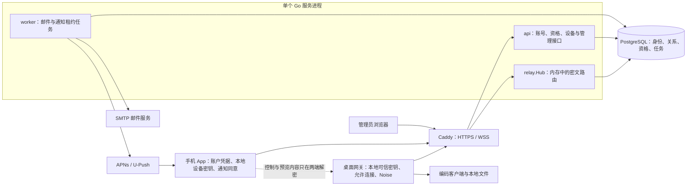
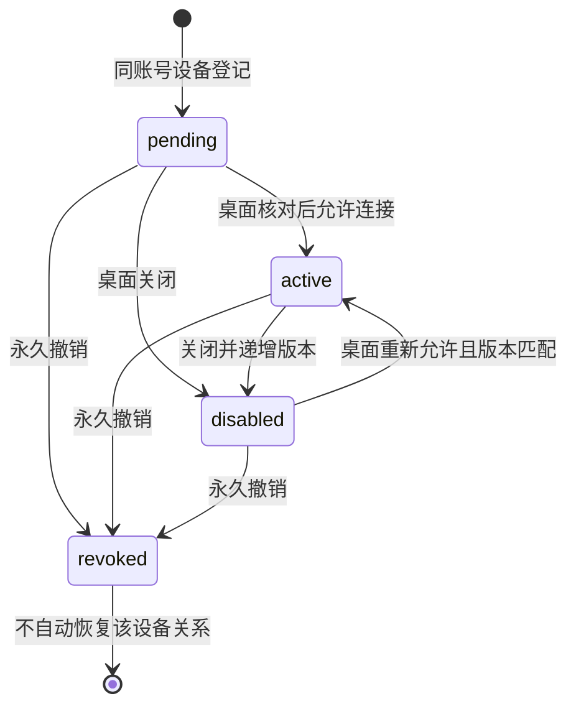

# Agent Note: Server 全局架构、授权逻辑与范围审查

Status: implemented

## Problem

账号、服务天数、设备发现、桌面授权和通知同意分别控制不同的事情。它们同时变化时，仅看单个模块或历史测试结果，容易把“登录成功”“设备在线”“允许连接”“允许推送”混成同一种权限，也容易把已经调整的产品要求误判为实现偏离。

本篇保留整个服务端的职责、信任关系、状态组合和真实取舍，并记录与目标不一致的行为，供维护者检查整体逻辑。它不替代部署操作手册。

## Decision

服务端采用 MIT 开源的 Go + PostgreSQL 单体，同一份代码支持 `hosted` 和 `selfhost`。PostgreSQL 保存账号、设备关系、服务天数和后台任务；WebSocket 中继的在线路由只保存在单个进程内。服务端不执行编码客户端会话，也不持有端到端加密的控制私钥或预览私钥。

手机请求通道的自然关闭与共享桌面连接分离，已关闭通道的迟到记录仅在当前网关的有界身份记录内忽略，见[中继关闭隔离](../bug-fix/2026-11-04-relay-channel-close-isolation.md)。旧实现会把正常关闭回执误当非法路由并断开整个网关，该路径已修复。

账号决定资源归属，托管服务天数决定云服务资格，桌面本地可信密钥和连接开关决定手机能否访问桌面，手机的独立同意决定通知资格。这四层相互关联，但不能互相替代。自动发现只建立关系，不自动建立桌面信任。

**F1/F2 和 F4/F5 的代码缺口已修复，F3 按用户明确选择保留默认首登。** [推送撤回](../bug-fix/2026-11-04-push-withdrawal-independent-of-desktop-access.md)、[当前账号和绑定结构](../simplification/2026-11-04-prerelease-account-and-binding-schema.md)及[管理与审计](../bug-fix/2026-11-04-admin-management-and-audit.md)分别持有修复决定，原始复现证据保留。真实部署恢复、容量与设备验收仍有本文所述边界。

## 审查范围与已有记录

审查日期为 2026-11-03（Asia/Shanghai），对象是本地 `codex-mobile-bridge-server` 工作树，HEAD 为 `78d4e6f`，包含审查开始前已有的未提交文件和迁移 004–007。HEAD 单独不能代表本篇描述的代码。审查覆盖启动与配置、全部生产 Go 模块、数据库迁移、管理页的数据入口、Compose、CI 和部署文档；桌面侧只核对连接授权与加密入口。没有连接生产数据库，也没有重新确认部署镜像、手机运行状态或厂商送达。

判断依据是既定的双模式账号方案，以及邮箱先验证、同账号自动发现、桌面开关授权等后续要求。实现事实以源码为准，历史部署和跨端验收以各自记录的时间为界。

新建前按账号、邮箱、配对、目录、推送和管理员关键词检索的记录归属如下：

| 记录 | 分类与处理 |
| --- | --- |
| 本仓 `.agents/notes/`、`docs/adr/`、`docs/decisions/` | 审查开始时均不存在；无 proposed / implemented / rejected 旧笔记可更新、合并或归档。本篇是首份全局架构记录。 |
| [README](../../../../README.md) | 部分重叠：保留使用入口，双方互链，不复制本篇审查细节。 |
| [部署文档](../../../../docs/deployment.md) | 部分重叠：保留配置、备份恢复和运维步骤，双方互链；本篇只记录运行假设和限制。 |
| [实现状态](../../../../docs/implementation-status.md) | 部分重叠：保留有日期的实现与验证证据，双方互链；历史“本地完成/已部署”不升级为当前事实。 |
| 桌面仓库的 `2026-11-02-email-first-registration.md`、`2026-11-03-desktop-approved-cloud-pairing.md`、`2026-11-03-account-device-auto-discovery.md` | 外部需求依据，由客户端仓库持有；本篇不接管其客户端决定。手动申请及关闭即永久撤销的描述不作为当前自动发现的要求。 |

没有删除或归档已有文档。全局记录只持有服务端的总体关系；以后某项决定翻转时，应另写对应决定并互链，不把这里的缺口改写成“从来没有”。

## 系统分工和信任关系



- **服务器可以知道**账号、邮箱、设备名称与公钥、绑定关系、在线情况、通知 ID、到期时间、密文长度和流量时序。设备推送 token 和邮件正文在数据库中加密，但服务器持有解密用的 `BRIDGE_DATA_KEY`，因此这些数据不是对服务器保密的 E2EE 数据。
- **服务器不应知道**聊天、命令、文件和通知预览的明文。`relay` 转发不透明记录；内容密钥在桌面与手机上。服务器声明绑定为 `active` 本身不是桌面本地信任。
- **桌面负责最后一层许可**：`CloudChannel.run` 在处理业务请求前完成 Noise 握手、密钥确认并查本地 pin；`CloudConnector.pin` 还检查本地连接开关。首次打开开关核对加密证明、安全码和设备密钥；关闭先阻断本地权限及通道，再访问云端。安全码绑定 origin、桌面/绑定身份、共享秘密及双方控制/预览公钥。
- **selfhost 部署者独立持有配置**：无需官方账号、付费许可服务或推送代理；需要第三方推送时，自行提供匹配应用的凭据。私有运维仓库不是本服务启动依赖。

桌面侧核对入口是 `codex-mobile-bridge` 的 `bridge/features/network/cloud_connector.py` 中 `CloudChannel.run` / `CloudConnector.pin`、`cloud_account.py` 中 `set_binding_access`、`cloud_crypto.py` 中 `pairing_safety_code`。这只是关键调用点走查，不是本次完成了整个客户端安全验收。

## 模块、数据和运行方式

| 模块 | 主要职责 | 状态归属与重要限制 |
| --- | --- | --- |
| [main](../../../../cmd/bridge-server/main.go)、[config](../../../../internal/config/config.go) | 配置校验、迁移、管理员初始化、启动和关闭 | `serve` 先迁移，再启动 HTTP、4 个推送 worker、1 个邮件 worker及清理循环；`migrate` 不启动发送 worker。模式来自服务器配置。 |
| [api](../../../../internal/api/server.go) | 路由、Host/TLS、JSON、认证、CSRF、限流和管理页 | 账户令牌、设备令牌与网站 Cookie 分开验证；部分业务更新直接通过 `Store.Pool` 执行 SQL。 |
| [store](../../../../internal/store/store.go) | 事务、资格、绑定、持久队列和迁移 | 是共享数据库访问层；业务条件还分布在 API 和 worker，不能把全部权限检查假定为只在此处实现。 |
| [relay](../../../../internal/relay/hub.go) | 网关连接、手机通道、帧路由、断开和定时复查 | 内存 map + 有界队列；重启即断开，没有离线命令队列或跨实例连接目录。 |
| [worker](../../../../internal/worker/worker.go)、[push](../../../../internal/push/providers.go) | 认领任务、重新判断资格、发送和记录结果 | PostgreSQL 租约可恢复；厂商接受、手机持久化 ACK、用户看见通知是不同事件。 |
| [security](../../../../internal/security/security.go) | Argon2id、随机 token/ID、摘要和 AES-GCM | `data_key` 保护邮件与推送 token，不是端到端内容私钥。 |

数据库中的账号是资源根：`accounts` 关联 `entitlements`、`sessions`、设备和兑换记录；设备关联登录会话；`bindings` 连接一个桌面与一个手机；每个 binding 最多一个 `push_endpoints`，通知任务和 ACK 使用 `(binding_id, notification_id)` 去重。公开注册另用 `registration_challenges`，不先创建带密码的账号。

迁移按文件名排序，在同一事务及 advisory lock 下运行；`schema_migrations` 只记录文件名和执行时间，不核验历史 SQL 的内容哈希。已执行迁移不能靠原地编辑重新生效。001 建立核心表，002 增加保留期，003 限制管理员初始凭据，004 邮箱验证码，005 邮箱优先注册，006 无到期手动申请及设备标签，007 自动目录与可逆开关。升级兼容性需要三端一起确认，不能只检查 SQL 成功。

## 四条主要业务链路

### 1. 账号、注册和会话

`hosted` 的新注册依次调用 `registration-code → registration-verify → register`：验证码 6 位、10 分钟有效、最多 5 次错误尝试；验证成功换取另一个 10 分钟有效的单次证明，最后才接收密码并创建已验证账号。证明绑定精确 origin/email；重发使旧码和证明失效。注册成功不自动登录、不增加服务天数、不授权设备。持久化限流在 IP 和身份两个维度生效。

`selfhost` 无公开注册，管理员创建本地用户名账号。普通用户密码由 Argon2id 保存。登录发放 15 分钟 access token 与最长 30 天会话的 refresh token；刷新轮换两种 token，但不延长该会话的原始 refresh 到期日。已用 refresh token 重放会撤销所属会话。网站会话只授予管理员，Cookie 有效期为 12 小时，写请求检查 Origin 和 CSRF。

设备 token 与其登录会话关联，访问时检查账号和 refresh 会话有效性，不要求每次都提交 account access token。同 ID、同公钥重新登记可以更新设备 token 和所属会话；换钥或已经永久撤销的设备不能冒用原 ID。退出、密码重置和会话撤销使设备访问失效，但不回收或恢复两端 E2EE 私钥。

依据：[注册事务](../../../../internal/store/registration.go)、[账户与令牌](../../../../internal/store/auth.go)、[设备登记](../../../../internal/store/devices.go)。旧验证分支与这个新流程的冲突见审查发现 F2。

### 2. 服务天数与兑换

`hosted` 在云连接、授权开启和通知发送等入口检查服务器端资格；到期账号仍可登录、查询和兑换。`selfhost` 跳过付费天数检查，但不跳过身份、账号禁用或设备授权。

兑换码是随机 16 位 Base32、80 位熵的单次服务天数凭证；数据库只保存摘要，明文仅在生成批次返回。一个账号下的设备共享有效期。兑换事务锁住账号、兑换码和 entitlement，按 `max(数据库当前 UTC 时间, 现有有效期) + 天数` 延长；`request_id` 固定一次请求的码，同账号重试同一码不会重复延长。兑换不会创建或批准 binding。

管理员网页负责生成、导出和撤销未使用的码；普通用户兑换使用客户端 bearer 接口，网站 Cookie 不可兑换。服务端没有在线支付、自动续费、退款、分层或按量计费。依据：[entitlements](../../../../internal/store/entitlements.go)、[redeem API](../../../../internal/api/auth.go)、[管理接口](../../../../internal/api/admin.go)。

### 3. 自动发现、桌面授权与中继

设备登记在账号锁内为同账号的桌面和手机补齐稳定 `pending` 关系，两个登录顺序都成立；任何既有关系，包括永久撤销记录，都会阻止自动重建该对设备的关系。目录 GET 不创建绑定或授予权限，手机目录 GET 只额外更新 `last_seen_at`。



| 条件 | 目录 | 中继/业务访问 | 通知 |
| --- | --- | --- | --- |
| `pending` | 保留 | 服务端允许转发不透明的握手/证明记录；桌面本地 pin 阻止未获批业务请求 | 不允许提交通知 |
| `active` | 保留 | 还要满足账号、设备会话、托管资格及本地可信密钥/开关 | 还要满足独立 consent、endpoint 版本和任务有效期 |
| `disabled` | 保留密钥与关系 | 拒绝新通道，关闭目标手机现有通道 | 取消 queued/leased 任务，独立 consent 可由有效手机按所有权撤回 |
| `revoked` | 保留撤销事实 | 拒绝；登记和目录同步不自动复活 | 绑定撤销同时清除 endpoint 的 enabled/consent 并取消待发送任务 |
| 离线、会话过期或服务天数到期 | 身份记录仍保留 | 不满足连接资格；离线与禁用不是同一种状态 | worker 发送前复查资格 |

`access_revision` 是开关操作的版本号。开启必须匹配当前版本，关闭可接受较旧版本并再次递增，因此迟到的开启不能覆盖关闭。云端检查 gateway 设备身份和手机公钥；安全码与本地 pin 的核验发生在桌面，不能只测 HTTP 返回 `active` 就认定已通过加密授权。

WebSocket 使用 `bridge-relay-v1`，拒绝浏览器 Origin 和 URL query。帧含版本、类型、binding ID、channel ID；单条明文上限 32 KiB，加密记录上限再加 16 字节，帧头 34 字节。每个连接输出队列 8 条，慢消费者断开；默认总连接 1024、每桌面手机通道 16、每连接入站每秒 1 MiB。这些是配置限制，不是实测容量。

账号/会话/设备/绑定的显式撤销会调用 Hub 关闭接口；自然到期和未即时关闭的数据库状态变化由 30 秒一次复查发现，单次检查超时为 5 秒。不能承诺所有失效都在同一毫秒生效。控制请求不落持久队列；不确定写入结果的处理仍由客户端协议负责。

`gateway_online` 来自当前进程的连接 map；`mobile_online` 来自最近 12 秒的目录访问及会话有效性，不能表示后台推送可达。手机首页只显示在线云设备是后续展示要求，不要求服务端删除离线身份。数据入口：[device_directory](../../../../internal/store/device_directory.go)、[device API](../../../../internal/api/devices.go)、[Hub](../../../../internal/relay/hub.go)。

### 4. 通知与邮件任务

手机为绑定登记自己的 provider/token/consent，服务器加密保存 token 并给 endpoint 分配 revision。桌面提交绑定范围内的随机 notification ID、过期时间和加密预览；服务器验证外层结构与大小，不解密预览。预览密文限制对应最多 1 KiB 明文，完整 APNs JSON 最多 4 KiB。

直达链路 ACK 延长 45 秒 `direct_until`；云任务在租约到期后才有资格交给厂商。ACK 可先于任务落库，后到任务直接成为 `acked`。推送 worker 用 `FOR UPDATE SKIP LOCKED` 认领 60 秒租约，发送前复查 binding、双方会话、账号、天数、consent、endpoint revision、有效期和 ACK；最多 6 次尝试，结果未知可重试同一通知 ID。因此这里是可重复投递加终端去重，不是服务端保证只投递一次。

状态包括 `queued / leased / accepted / acked / cancelled / expired / failed`。`accepted` 仅表示厂商受理；只有手机持久化接收事实后才应 ACK。关闭或撤回可阻止后续派发，但不能撤回已经提交厂商的通知；发送前检查到实际 HTTP 请求之间也存在并发窗口，终端仍需执行本地同意与去重规则。

邮件 outbox 与注册/重置事务一起落库，正文使用 AES-GCM；邮件 worker 检查挑战所有者、过期和失效状态，最多尝试 6 次。SMTP 必须校验证书并使用 STARTTLS 或隐式 TLS。邮件不属于端到端保密内容。

依据：[push store](../../../../internal/store/push.go)、[worker](../../../../internal/worker/worker.go)、[providers](../../../../internal/push/providers.go)、[SMTP](../../../../internal/worker/smtp.go)。

## 审查发现与目标差异

### F1：关闭连接后无法撤回推送同意（已修复）

当前关闭分支独立核对有效调用方手机和绑定所有权，不要求桌面访问或托管资格，启用仍保留原严格条件；恢复访问不恢复撤回的 consent。以下保留修复前的失败证据，当前 API/PostgreSQL 回归覆盖四种访问丧失状态和跨手机/账号拒绝。

[RegisterEndpoint](../../../../internal/store/push.go) 在处理 `enabled=false` 或 `consent=false` 之前调用 `Binding(..., false)`。该查询要求 binding 为 `active`，并且桌面和手机的会话都有效。手机自身登录有效、且只想撤回自己的通知同意时，也因此被桌面的禁用/退出状态拦住。

隔离 HTTP 探针覆盖两种情形：先启用合成推送 endpoint，然后分别关闭桌面连接开关、撤销桌面会话，再用仍有效的手机 token 撤回通知同意。两种情形都返回 **403**，数据库的 `consent` 和 `enabled` 仍为 **true**；重新允许连接后，目录中的 `push_enabled` 又成为 true。这个观察不代表实际向手机发送了通知，但证明服务器没有落下撤回结果。

修复方向：撤回入口只校验手机自身身份和 endpoint/binding 所有权，允许关系禁用或对端会话失效；把 active、服务天数、provider 和 token 校验留在启用分支。保留跨账号隔离、事务取消 queued/leased 任务，并覆盖“撤回后重新允许连接不会恢复推送资格”的回归断言。这里不需要降低业务连接的认证要求。

### F2：历史验证接口仍可启用旧密码（已移除旧路径）

当前注册仅经[邮箱证明与密码完成](../../../../internal/api/registration.go)，旧 `verification / verify-code`、`ConsumeEmailCode` 和账号绑定验证码表已删除。已有账号即使未验证，也不能被注册流程覆盖；旧开发库没有升级兼容。修复前，旧接口可重新生成验证码并直接设置 `verified=true`，不替换预存密码。

隔离探针保留一个历史未验证账号，完成新流程的邮箱验证但不提交新密码；模拟重发冷却期经过，再调用旧 `verification` 获取新码、调用旧 `verify-code`。验证和旧密码登录均返回 **200**。因此“新的验证成功只发注册证明”成立于新接口，但不覆盖整个服务端暴露面。此问题要求已有历史未验证账号和有效邮箱验证码；没有证据表明可无验证码接管账号。

[部署文档](../../../../docs/deployment.md#email-verification-codes)现已同步为唯一注册流程和新开发库初始化。用户明确无需历史数据，当前选择删除旧激活入口；旧路由拒绝、证明单次消费及不覆盖既有账号由回归验证。

### F3：默认管理员首次认领（用户确认保留的取舍）

[配置默认值](../../../../internal/config/config.go)、[初始化脚本](../../../../scripts/init_deployment.py) 和本机 `reset-admin` 路径允许 `admin/admin` 进入 setup，再由持有 setup token 的人改成自己的强密码。限制普通会话和强制改密能阻止直接使用默认口令管理业务，却不能证明最先改密的人就是部署者。网站 CSRF 也不能解决首次所有权认领。

该行为在部署文档中作为后续管理员体验选择公开记录；README 的 `--admin-login operator` 示例会生成随机初始密码，但部署文档和脚本默认路径仍可能使用已知密码。风险成立于首次 setup 或本机重置后、管理入口对外开放且尚未完成认领的窗口；本次没有核实生产是否处于该状态。

用户在 2026-11-04 明确要求保留 `admin/admin`，用于部署后首次登录。本轮已撤回随机默认密码的改动，保留首次登录只得十分钟 setup 权限、强制更换密码、重新登录和启动不重置已有管理员。默认配置、初始化及本机 reset-admin 行为不变，README 以默认首登为快速入口；公开首次认领窗口仍是该选择的后果，不宣称已消除。真实合成浏览器和既有 API 回归均验证 setup 无普通管理/设备权限。

### F4：管理员按用户管理设备、绑定和会话（已补齐）

[loadDevices / loadSessions](../../../../internal/api/web/app.js)现在使用独立的 `/v1/admin/users/{account}/...`，页面明确选定账号并显示其 desktop/mobile、绑定和会话，可逐项撤销。普通 `/v1/gateways` 等仍只返回本人数据。写入在锁定后复查管理员角色、有效会话、目标账号及资源归属，事务提交后关闭指定 socket，设备撤销级联关闭绑定并取消 queued/leased 推送。

原省察发现管理员页面只能看本人且用户/审计截断 200 条。当前搜索由服务器执行，全部管理列表采用默认 50、最大 200 的稳定游标页；215 个同创建时间账号的遍历和未加载用户搜索已有回归。客户端新搜索/切账号丢弃旧响应。游标是位置而非权限，参数只开放给明确管理员 GET，普通 API/WebSocket 查询限制不变。

### F5：兼容路径与运维证据仍有收口空间（维护债务）

- 手动 `pairing-requests`、旧 approve/撤回、`NewPairing/JoinPairing` 和 `pairings` 表已协同移除，桌面和 App 调用方也已更新。当前只接受新 schema，旧开发迁移历史明确拒绝；这取代了审查时为其他消费者和旧记录保留迁移的前提。
- 审计现覆盖设备登记/重新登记/撤销、关系发现/开关/撤销、会话创建/显式撤销/密码失效、推送同意和管理员账号/资格变更；记录操作者、作用账号、设备/会话及前后状态，与变更同事务。秘密、密钥、正文不入审计；无变化轮询不追加记录。账号禁用记录前后布尔值，审计失败回滚业务，ID 保留以追踪已删除账号。
- `implementation-status` 同时保留多个历史“本地完成/已部署”段落；部署文档对离线可见、旧注册兼容和备份演练的描述也有时间或接口范围差异。server 目录保留离线记录是正确的数据行为，不能拿这句替代“手机首页隐藏离线设备”的展示要求。恢复演练是否覆盖当前版本，应查对应版本证据。

## 部署、故障与已知上限

部署由 Caddy、单个 server 和 PostgreSQL 组成，只有 Caddy 发布 443；数据库使用内部网络，后端不直接公开。应用校验精确 Host，并只信任配置中的代理地址对 HTTPS 的声明。SMTP、APNs 和 U-Push 是按配置启用的外部依赖，不是 selfhost 的官方代理依赖。

无 Redis 和多节点中继是首版范围选择。即使多个 worker 能靠数据库租约分工，也不能直接增加 server 副本：网关与手机可能落在不同 Hub，在线目录及即时断开也只作用于单进程。增加副本前需要解决连接归属、路由和跨进程撤销；本篇不替这些扩展选型。

服务重启丢失在线通道，但数据库任务可以重新认领。数据库不可用时 `/readyz` 失败，`/healthz` 仍可成功；已建立中继依赖下一轮资格复查中断。readiness 只证明数据库可达，不证明邮件可送达、推送可达、所有 worker 正常或容量足够。管理指标中的手机数是当前中继连接数，也不是去重后的所有在线手机数。

默认每账号最多 8 台桌面、16 个手机安装、32 个有效登录会话；客户端目录查询仍最多 200 条，历史身份和永久撤销事实保留，因此自定义更高设备上限需重审客户端目录；管理员各列表已分页。清理每分钟运行、每条语句至多处理 1000 条，通知任务在过期一天后清理、ACK 在到期后清理；被设备引用的历史会话不按时间删除。账务与审计没有自动裁剪策略，清理失败现输出不含私密数据库信息的结构化错误并按周期重试。

数据库和原始 `data_key` 必须关联恢复；丢失该 key 会失去邮件/token 加密数据，但它仍不能恢复用户设备 E2EE 密钥。运行 `migrate` 与启动完整服务不同：后者可能恢复真实邮件/推送任务。当前有备份恢复操作文档，没有通用自动回滚或 data-key 轮换机制；不把恢复旧镜像等同于数据库降级。

## Alternatives considered

以下只记录实际出现过的方案；Go 与其他语言、PostgreSQL 与其他数据库的比较没有足够记录，本篇不补造选型故事。

1. **手动选择桌面、申请配对或扫描云二维码。** 明确选定目标、只创建用户主动请求的关系，可以减少自动目录中的候选项。但当前产品要求手机登录后同账号设备自动出现，由桌面逐台授权；因此服务端采用稳定目录关系，并保留本地加密证明和安全码，避免把自动发现等同于信任。代价是必须维护 pending、离线、同名设备和迁移记录。依据为配对与自动发现的既有客户端记录及迁移 006–007。
2. **关闭连接即永久撤销并删除可信密钥。** 撤销语义直接，重新连接自然要求重新核验。但它不满足“以后直接重新开启”的要求；当前用独立 `disabled` 和本地访问状态保留核验事实，以版本号阻止迟到开启。代价是连接许可与推送同意的状态组合更多，F1 正是这个组合没有完全覆盖。
3. **先提交邮箱密码建未验证账号，再验证邮箱。** 一次表单可以同时收集凭据，已有账号验证代码可直接复用。但当前注册要求邮箱验证在先、密码在后；因此新增独立挑战与单次注册证明。代价是增加挑战、证明、重发失效和旧账号兼容逻辑；F2 表明保留历史激活分支会削弱统一语义。

## Consequences

统一代码和 PostgreSQL 事务让自部署、账号资格、兑换及可靠后台任务集中维护；同账号目录改善发现流程，本地 pin 仍把最后的设备信任留在桌面；控制数据不在云端落成可重放命令。这些收益同时带来单进程中继的容量上限、数据库依赖、三端协同升级，以及多种权限组合的测试成本。

F1/F2、F4 的管理范围及 F5 的授权审计已完成；F3 的 admin/admin 默认入口由用户明确保留并验证 setup 边界。历史实现/部署记录保留各自日期，当前证据另存，不能把合成回归外推到真实恢复、压测或厂商送达。

当单实例连接/带宽达到实测瓶颈、用户和记录超过列表上限、需要逐用户设备处置、或需要证明完整授权历史时，应重新审视相应限制。当前没有压测基线、RPO/RTO 实测或生产版本对应的全套验收证据，不能用默认配置数值或历史绿色测试替代这些结论。

## Testing

前一轮兼容清理有 98 个 Go 通过事件，材料保留在 `D:/github/.codex-tools/architecture-closeout-20261104/`。本轮管理与审计补齐后 Go 104 个通过事件、无失败和跳过，vet/模块/格式、9 项 Node、9 项 Python 及公开向量通过。Edge/WebKit 的英文宽屏与中文窄屏四组真实本地服务验收通过，覆盖 admin/admin 首次改密、分页/搜索/跨用户处置和审计，截图已检查；材料位于 `D:/github/.codex-tools/server-remediation-20261104/`。未运行 Windows CGO race 或生产操作。

### 原始省察证据

验证使用 Go 1.27.3、单独创建的 PostgreSQL 18.1 回环测试实例，以及合成账号、密钥和推送 token。没有配置实际厂商发送或 SMTP 投递。HTTP 审查探针直接经过 `api.Server` 和真实数据库事务，避免只凭函数名推断权限组合。

| 检查 | 本次结果 | 证明范围 |
| --- | --- | --- |
| `go test -json -count=1 -p 2 ./...` | 106 个测试事件通过，0 失败、0 跳过 | 包含数据库集成与迁移用例；不是新增审查断言的结果，也不是 Linux race 或跨端真实操作。 |
| `go vet ./...` | 通过 | 静态检查。 |
| `node --test scripts/tests/redemption_ui.test.cjs` | 4 项通过 | 使用模拟 DOM/网络的兑换码显示、复制、导出；没有打开真实管理页或生成生产码。 |
| `python -B -m unittest discover -s scripts/tests -v` | 9 项通过 | 初始化/部署辅助函数。 |
| `scripts/protocol_vectors.py --check` | 通过 | 公开固定向量与存量文件一致；固定临时密钥仅为向量测试，不能证明真实设备握手、密钥保管或推送送达。 |
| `go test -count=1 -overlay <审查覆盖文件> -run '^TestArchitectureAudit' -v ./internal/api` | 两组审查断言失败，命令退出 1 | 推送组的禁用绑定、撤销桌面会话两种情形均复现 F1；历史注册组复现 F2。没有把失败改成通过或跳过。 |

审查探针通过 Go `-overlay` 注入虚拟测试文件，没有改动仓库业务源码或既有测试。其期望断言是“有效手机可以撤回自身通知同意”和“邮箱先验证后不能靠历史分支启用先前密码”；失败正是本篇保留的未解决问题。其余只做源码确认的限制均未冒充动态复现。

本机原始材料位于 `D:/github/.codex-tools/server-architecture-audit-20261103/`：`baseline.json` 保存审查前 96 个仓库文件的 SHA-256，`go-test.jsonl`、`go-vet.log`、`node-tests.log`、`deployment-tests.log`、`vectors.log` 保存常规结果；`architecture_audit_test.go`、`overlay.json`、`audit-probes.log` 保存失败复现。该临时目录不随服务端仓库提交；F1/F2 的操作步骤与观察结果已直接写在本篇中。

笔记验证从服务端仓库根目录调用已安装 skill 的三个脚本；本仓没有额外引入 npm 工程或 CI 改动：

```powershell
npx --yes tsx C:/Users/Administrator/.codex/skills/write-notes-like-deepseek/scripts/verify-agent-note-tree.ts
npx --yes tsx C:/Users/Administrator/.codex/skills/write-notes-like-deepseek/scripts/verify-agent-note-format.ts
npx --yes tsx C:/Users/Administrator/.codex/skills/write-notes-like-deepseek/scripts/verify-archived-agent-notes.ts
```

三项笔记校验通过：1 篇活跃笔记、0 篇归档；另核对 31 处文件/源码行链接。审查前后的文件哈希比较确认，仓库改动仅为本篇和 README、部署文档、实现状态中的入口链接。独立 PostgreSQL 测试实例已核验数据目录、进程和端口后停止，测试数据及日志保留。

未在本次重跑的内容包括 Linux race、容器/TLS 的实际部署、生产备份恢复、吞吐与故障压测、桌面/手机完整回归、签名设备加密操作和真实通知送达。已有 CI 配置和历史部署记录不代表这些检查覆盖当前工作树。
